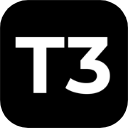
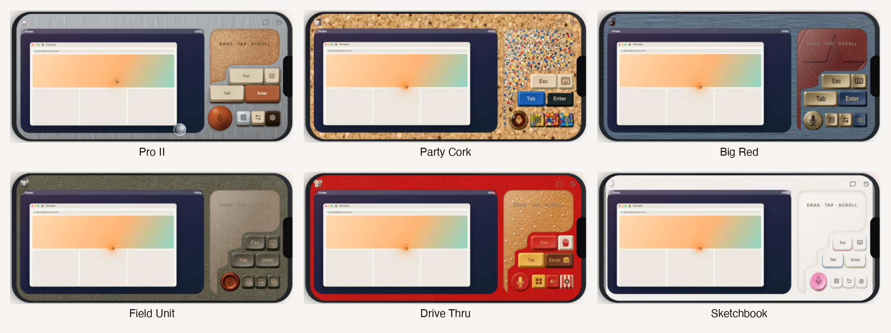
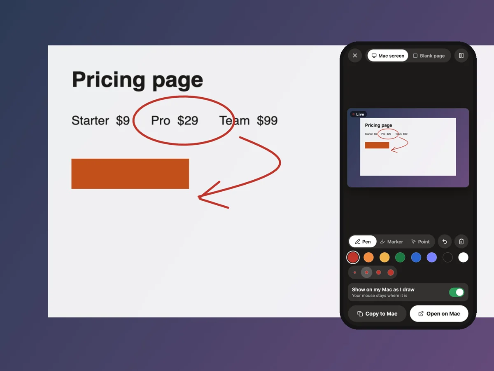
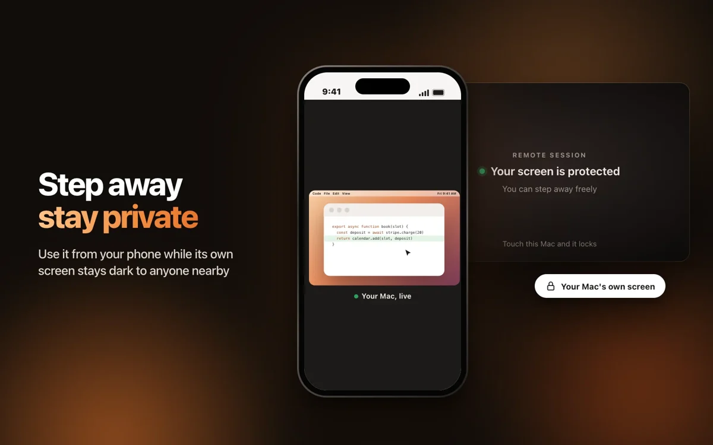

<p align="center">
  
</p>

<h1 align="center">MightyMouse - Make your computer 100x more useful</h1>

<p align="center">
  Free voice typing, no word limit. Every AI agent, side by side.<br>
  Reach your computer from anywhere.
</p>

<p align="center">
  <a href="https://getmightymouse.com/download"></a>
  <a href="https://apps.apple.com/us/app/mightymouse-build-with-ai/id6796192096"></a>
  <a href="https://play.google.com/store/apps/details?id=com.mightymouse.android"></a>
</p>

<p align="center">
  <a href="LICENSE"></a>
  
</p>

<p align="center"><b>The $0, open-source replacement for</b></p>

<table align="center">
  <tr>
    <td align="center" width="96"><a href="https://getmightymouse.com/vs/conductor/"><br><sub>Conductor</sub></a></td>
    <td align="center" width="96"><a href="https://getmightymouse.com/vs/t3-code/"><br><sub>T3 Code</sub></a></td>
    <td align="center" width="96"><a href="https://getmightymouse.com/vs/clicky/"><br><sub>Clicky</sub></a></td>
    <td align="center" width="96"><a href="https://getmightymouse.com/vs/t3-chat/"><br><sub>T3 Chat</sub></a></td>
    <td align="center" width="96"><a href="https://getmightymouse.com/vs/wispr-flow/"><br><sub>Wispr Flow</sub></a></td>
  </tr>
</table>

<p align="center"><b>Works with the AI you already pay for</b></p>

<table align="center">
  <tr>
    <td align="center" width="96"><br><sub>ChatGPT</sub></td>
    <td align="center" width="96"><br><sub>Claude</sub></td>
    <td align="center" width="96"><br><sub>OpenRouter</sub></td>
  </tr>
</table>

<p align="center">
  <a href="#how-it-compares"><b>How it compares</b></a> &nbsp;·&nbsp;
  <a href="#coming-from-conductor"><b>Coming from Conductor?</b></a> &nbsp;·&nbsp;
  <a href="#make-it-yours"><b>Skins and more</b></a> &nbsp;·&nbsp;
  <a href="#run-it-yourself"><b>Run it yourself</b></a> &nbsp;·&nbsp;
  <a href="#for-builders"><b>Help build it</b></a>
</p>

<p align="center">
  
</p>

## Bring any AI, keep the plan you pay for

MightyMouse doesn't sell you a model. It runs the ones you already use, signed in with your own accounts, and you can switch any time.

| | Works with |
| --- | --- |
| **Coding agents** | Claude Code · Codex · Cursor · OpenCode |
| **Chat** | Claude · ChatGPT models through Codex · Gemini · any model on OpenRouter |
| **Offline, on your own computer** | Ollama · Rapid-MLX on Apple Silicon |

<p align="center">
  
</p>

Each one is a single adapter in [`src/main/backend/adapters.ts`](src/main/backend/adapters.ts), so the next one is a small pull request away.

## On your computer

<p align="center">
  
</p>

**One home for your coding agents.** Give each agent its own branch, run a few side by side, then review every changed line, open the pull request and merge without leaving the app.

<table>
  <tr>
    <td width="50%" valign="top">
      
      <h3>Pick the model and how hard it thinks</h3>
      <p>Choose Claude, Codex or OpenCode, then turn the dial from quick to deep. Switch on Plan first and nothing changes until you say go.</p>
    </td>
    <td width="50%" valign="top">
      
      <h3>Every agent on one board</h3>
      <p>See which agents are working, which handed work back and which need you, across every project.</p>
    </td>
  </tr>
</table>

<table>
  <tr>
    <td width="50%" valign="top">
      
      <h3>Talk and it types</h3>
      <p>Hold <kbd>fn</kbd> and talk. Your words land where your cursor is, in any app. Speech turns into text on your own computer, so it is free and stays private.</p>
    </td>
    <td width="50%" valign="top">
      
      <h3>Better words, right where you are</h3>
      <p>Select text in any app and tap a fix: shorter, cleaner, easier to read, or ask for anything. The new words replace the old ones in place.</p>
    </td>
  </tr>
</table>

## Agents that keep going while you're out

<table>
  <tr>
    <td width="50%" valign="top">
      
      <h3>Answer from the lock screen</h3>
      <p>An agent's question arrives with its choices as buttons. Tap one and the work keeps going. Approvals ask for Face ID first.</p>
    </td>
    <td width="50%" valign="top">
      
      <h3>Your computer in your hand</h3>
      <p>Your phone shows your live screen and turns into a trackpad, a keyboard and a microphone. Fix a typo from the couch or check on an agent from the kitchen.</p>
    </td>
  </tr>
</table>

| You get | What it means |
| --- | --- |
| **Close the lid, work continues** | Turn it on and your computer stays awake with the lid shut, so busy agents keep going and your phone still reaches them. |
| **Everything waiting, in one stack** | Swipe through every agent that needs you, one card at a time. |
| **Undo to any message** | Put the files back to how they were before any earlier message. |
| **A dark screen for the room** | While you drive from your phone, the computer's own screen stays black to anyone nearby. |
| **Show it, don't explain it** | Tap for a screenshot or hold to record your screen and voice, and get the transcript. |

<p align="center">
  
  
  
</p>
<p align="center"><sub>Straight from the phone: trackpad, full keyboard, and a screen full of agents at work.</sub></p>

## Make it yours

<p align="center">
  
</p>

**Skins for the phone remote.** Brushed steel, cork, leather, a red diner, a sketchbook. Pick one in the phone's Settings > Display > Skin, and new ones arrive in the skin store without an app update. Want to make your own? See [Make a skin](#make-a-skin).

<table>
  <tr>
    <td width="50%" valign="top">
      
      <h3>Draw on your screen from your phone</h3>
      <p>Pen, marker or laser pointer, right on the live screen. Circle it, point at it, scribble on it, then copy the result. Phone Settings > Draw on your Mac.</p>
    </td>
    <td width="50%" valign="top">
      
      <h3>A dark screen for the room</h3>
      <p>Drive the computer from your phone while its own screen stays dark to anyone nearby. Touch the computer and it locks.</p>
    </td>
  </tr>
</table>

| Also on the phone | Where |
| --- | --- |
| **A cursor with a trail** - Comet, Mouse or Sparkle trail | Settings > Trackpad > Animated cursor |
| **Huge cursor and Find cursor** - for when you lose the pointer | Settings > Trackpad |
| **Big record button** - a giant mic for when the phone lies on the desk | Settings > Trackpad |
| **Your screen in your glasses** - Meta Ray-Ban Display, driven with your fingers | Pair the glasses like a phone |

## How it compares

T3 Code puts your agent on your phone. MightyMouse puts the whole computer there, agent included.

| | MightyMouse | T3 Code |
| --- | :---: | :---: |
| Runs Claude Code, Codex, Cursor and OpenCode | ✅ | ✅ |
| Each agent on its own branch, changed files, pull request and merge | ✅ | ✅ |
| Undo the files back to an earlier message | ✅ | ✅ |
| iPhone and Android apps | ✅ | ✅ |
| Open source, MIT | ✅ | ✅ |
| Your computer's live screen, trackpad and keyboard on the phone | ✅ | ❌ |
| Voice typing into any app, free and on your own computer | ✅ | ❌ |

An editor gives you agents inside one window. A chat app gives you one company's models. MightyMouse gives you every agent you pay for, across the whole computer, and lets you leave the desk.

### One app instead of five

| If you use | MightyMouse gives you |
| --- | --- |
| **Clicky** to talk you through your screen | Talk and it types into any app, with no monthly message cap. It runs on the AI plans you already pay for, and your phone becomes the remote |
| **Conductor** for agents side by side | The same Claude Code, Codex and Cursor agents plus OpenCode, your Conductor workspaces in one click, and answers from your phone |
| **T3 Chat** for many models in one chat | Claude, Gemini and any model on OpenRouter in one chat, signed in with your own accounts |
| **The ChatGPT and Claude apps** | Both, on the plans you already have, next to Gemini and models that run offline on your computer |
| **Wispr Flow** for voice typing | Speech turns into text on your own computer, free, with no word limit |

<sub>T3 Code checked against github.com/pingdotgg/t3code on 8 Nov 2026. Clicky checked against heyclicky.com on 9 Nov 2026 (free plan: 25 talk messages a month). Something out of date? Open an issue and we'll fix it.</sub>

## Coming from Conductor?

Bring your workspaces with you. MightyMouse finds the Conductor workspaces already on your computer and picks each one up in Claude Code, on its branch, with the end of the old chat so the agent knows where it stopped.

1. [Download MightyMouse for Mac](https://getmightymouse.com/download) and open it.
2. Go to **Code**. Your workspaces are listed under **From Conductor**.
3. Click **Continue here** on any of them.

From there you get what you had, plus your phone: plan first and change nothing until you say go, and merge the pull request from your pocket.

## Run it yourself

Just want to use it? Get the official apps from the buttons at the top: signed, and they update themselves.

To build it, you need a Mac and a current Node LTS release.

```sh
git clone https://github.com/royherma/mightymouse.git
cd mightymouse
npm ci
npm run dev
```

`npm run dev` starts the app with hot reload. Changes in `src/renderer/` show instantly. Changes in `src/main/` and `src/preload/` need the app restarted.

| To do this | Run |
| --- | --- |
| Make a production build | `npm run build` |
| Package the app | `npm run build:mac` |
| Rebuild the web app your phone loads | `npm run build:phone-remote` |
| Check types, lint and tests | `npm run typecheck` · `npm run lint` · `npm test` |

Apps you build yourself are not signed by Apple, so macOS asks you to confirm the first launch (right-click the app, then Open). The iPhone app lives in `ios/` (open it in Xcode) and the Android app in `android/` (open it in Android Studio).

### Free and paid

Everything that runs on your computer is free. Paid plans cover what runs on ours.

| | Free | Paid plans |
| --- | --- | --- |
| The app, voice typing, phone remote on Wi-Fi | ✅ Unlimited | ✅ Unlimited |
| Agents ask and you answer from your phone's lock screen | ✅ | ✅ |
| Coding agents and chat on your own Claude, Codex, Cursor, OpenCode, Gemini or OpenRouter account | ✅ Unlimited | ✅ Unlimited |
| Your computer from anywhere | ✅ Unlimited with your own Cloudflare Tunnel or Tailscale, or free minutes on ours | ✅ Ours, built in, unlimited |
| Our AI and cloud runs, no AI account of your own needed | ✅ A free weekly allowance | ✅ A bigger allowance, plus top-ups |

See [pricing](https://getmightymouse.com/pricing). Sign-in uses a free MightyMouse account.

**Your own tunnel.** The phone remote listens on port `17771`. Point any tunnel at it, open the address on your phone and approve the phone on your computer the first time:

```sh
cloudflared tunnel --url https://localhost:17771 --no-tls-verify
```

A quick tunnel gets a new address each run. A [named tunnel](https://developers.cloudflare.com/cloudflare-one/connections/connect-networks/) keeps one. With Tailscale, open `https://<your computer's Tailscale name>:17771` on the phone.

## For builders

### How it fits together

```
  coding agent (Claude Code, Codex, Cursor, VS Code)
        │  MCP over stdio
        ▼
  npm-shim/mightymouse-code        a thin pipe, no tool logic
        │  HTTP on 127.0.0.1
        ▼
 ┌──────────────────────── Mac app (Electron) ────────────────────────┐
 │  src/main           hotkeys, capture, speech to text, the agent    │
 │                     relay (the real MCP server), backend/runner.ts │
 │                     spawns the agent CLIs                          │
 │  src/preload        the window.api bridge                          │
 │  src/renderer       React UI, one entry per window                 │
 │  src/main/phone-remote   HTTP + WebSocket server and phone web app │
 └──────────────────────────────────┬─────────────────────────────────┘
                                    │  Wi-Fi
            ┌───────────────────────┼───────────────────────┐
     iPhone app (ios/)      Android app (android/)     phone browser
```

### Where things live

| Folder | What it is |
| --- | --- |
| `src/main/` | Electron main process: hotkeys, capture, transcription, the agent relay |
| `src/main/backend/` | One adapter per AI provider. `runner.ts` is the only place a model is called |
| `src/renderer/` | The React UI, one entry per window |
| `src/main/phone-remote/` | The server your phone connects to, plus the React app it loads |
| `src/shared/` | Code both sides use: `config.ts`, `types.ts`, `ipc.ts`, `shortcuts.ts` |
| `npm-shim/mightymouse-code/` | The connector that lets any coding agent notify, ask and get approvals through the app |
| `native/` | Small Swift and C helpers: input, screen capture, accessibility, audio |
| `ios/`, `android/` | The phone apps (Swift and Kotlin) |

Read [AGENTS.md](AGENTS.md) first. Deeper dives: [docs/agent-relay.md](docs/agent-relay.md), [docs/relay-contract.md](docs/relay-contract.md), [docs/phone-remote-flows.md](docs/phone-remote-flows.md), [docs/subsystems.md](docs/subsystems.md), [docs/conventions.md](docs/conventions.md) and [DESIGN.md](DESIGN.md).

### Good first areas to help

- **Bring another coding agent.** Each one is a single adapter in `src/main/backend/adapters.ts`.
- **Teach agents a new trick.** The tools an agent can call (`notify`, `ask`, `approve`, `show`) live in `src/main/agent-relay/mcp/verbs.ts`. Start with [docs/agent-relay.md](docs/agent-relay.md).
- **Design a skin.** A skin is one CSS file of colour and image tokens. See [Make a skin](#make-a-skin).
- **Make the phone feel better.** Trackpad, keys and the swipe stack are React in `src/main/phone-remote/react/`.
- **Faster, sharper speech to text.** The engines are wired in `src/main/capture/whisper.ts`.
- **Native screens on Android.** The Android app pairs by QR code and loads the same phone remote as the browser. The iPhone app goes further with native lock-screen answers; bringing those to Android is open.

### Make a skin

A skin repaints the phone remote without touching its layout: colours, the trackpad, the keys, the mic. A simple one is about 15 lines of CSS.

1. Create `src/main/phone-remote/react/skins/<your-id>.css` and set the tokens you want. Anything you leave out keeps the default look:

   ```css
   .proRoot[data-skin='midnight'] {
     --pro-bg: #0d1220;
     --pro-card: #182036;
     --pro-pad-bg: #222c48;
     --pro-key-bg: #2b3658;
     --pro-key-ink: #e8ecff;
     --pro-key-wall: #1c2440;
     --pro-key-wall-deep: #121830;
     --pro-accent: #7c8cff;
     --pro-accent-ink: #ffffff;
   }
   ```

   Every token, and the three that trip people up, are in [SKINS.md](src/main/phone-remote/react/SKINS.md).
2. Add one import line for it in `src/main/phone-remote/react/main.tsx`, add `'<your-id>'` to `PHONE_REMOTE_SKINS` in `src/shared/types.ts`, and add `{ id, label, blurb }` to `SKIN_OPTIONS` in `src/main/phone-remote/react/skins.ts`.
3. Run `npm run build:phone-remote`, open the remote on your phone and pick it in Settings > Display > Skin.
4. Open a pull request with a screenshot of your skin on a real phone.

Good ones go into the skin store, so everyone who uses MightyMouse can wear them.

## Contributing

Read [CONTRIBUTING.md](CONTRIBUTING.md). If you code with an agent, point it at [AGENTS.md](AGENTS.md). Found a security issue? See [SECURITY.md](SECURITY.md).

## License

[MIT](LICENSE)
